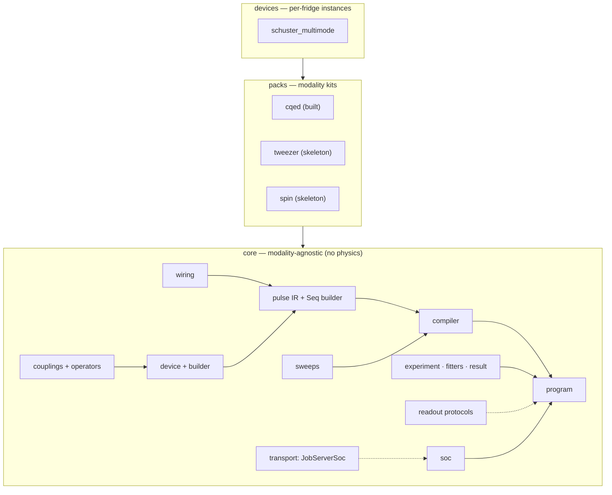

# Strumento

**Write quantum experiments in the language of your device — run them on QICK tProc-v2.**

Strumento is a first-principles [QICK](https://github.com/openquantumhardware/qick) tProc-v2
experiment framework: a device model, a typed pulse IR, a compiler, and an experiment/fitting
lifecycle — with a raw-qick escape hatch at every level. You describe operations on *named elements*
(`dev.qubit.ge_pi()`, a gain sweep, a readout); Strumento resolves the wiring, compiles to v2, and
gives you back typed results. Nothing is walled off — when you need raw qick, it's one call away.

It's a ground-up redesign of the core of Stanford's
[`SchusterLab/multimode_expts`](https://github.com/SchusterLab/multimode_expts) (a tProc-**v1**
codebase) — keeping the physics, discarding the architecture — and it's built to generalize: one
modality-agnostic `core`, swappable **packs** for superconducting / neutral-atom / spin qubits.

> 🔒 Private while the core is proven; open-source is the intent.

## A quick taste

```python
from strumento import Device, Seq, Sweep

dev = Device.load("devices/schuster_multimode/device.yaml")

# Amplitude Rabi — in device language, no register-level assembly.
# The gain sweep is just a value in the pulse; the compiler turns it into a loop.
rabi = Seq().play(dev.qubit.ge_pi(gain=Sweep("amp", 0, 30000, 51))).measure()
```

```python
# Run it as an experiment (acquire + fit), on hardware or the offline mock:
from strumento.packs.cqed.experiments.amplitude_rabi import AmplitudeRabi

outcome = AmplitudeRabi(dev).go(soc)
outcome.fit.derived["pi_gain"]        # the drive amplitude for a π rotation
```

Full walkthrough → **[docs/getting-started.md](docs/getting-started.md)**.

## Why Strumento

- **Model the device, not the FPGA.** Physical ops on named elements; a wiring layer maps them to
  DACs. Re-patching a cable is a one-line config edit — every experiment is untouched.
- **Typed pulses, computed from calibration.** No string keys, no `eval`. A pulse is a typed value
  from a factory that reads calibration.
- **Escape hatch everywhere.** `StrumentoProgram` *is* an `AveragerProgramV2` — splice a raw call
  mid-sequence, or hand-write a body, while still using the abstractions for everything else.
- **The pure layers need no board.** The IR, device model, builder, compiler, fitters, and job
  transport all import and unit-test with no `qick` installed.
- **A measurement *instrument*, not just a runtime.** Author a device in code or YAML, measure the
  as-built device, and export its Hamiltonian for optimal control — closing a hardware↔pulse loop.

## Status

The modality-agnostic `core` and the `cqed` pack are built and green end-to-end through **Slice 2**
(a pulse compiles onto the mock; amplitude Rabi with sweeps + fitting). The device model —
`DeviceBuilder`, typed couplings, and Hamiltonian export — is built (D30/D31); `tweezer` and `spin`
ship as pack skeletons. The suite runs offline and ~95% of the logic needs no `qick`.

> **One gate:** building a *real* `AveragerProgramV2` needs a **tProc-v2** (`qick_processor`)
> soccfg. The committed Schuster snapshot is tProc-**v1**, so the few tests that assemble a real v2
> program skip until a v2 `dump_cfg()` is dropped at `devices/_fixtures/soccfg_v2.json`. Everything
> else — building, compiling, fitting, the transport contract — runs today.

Roadmap: Slice 3 (T1/T2), Slice 4 (f0g1 + storage swap), Slice 5 (parity), Slice 6 (optimal-control
import). Details in **[docs/plan.md](docs/plan.md)**.

## Documentation

| Doc | What's in it |
|---|---|
| **[getting-started.md](docs/getting-started.md)** | Hands-on walkthrough with runnable examples — device, pulses, sequences, sweeps, fitting, experiments, the escape hatch, transport. |
| **[packs-and-devices.md](docs/packs-and-devices.md)** | How elements compose into a device, the `DeviceBuilder`, typed couplings + Hamiltonian export, and **how to add a modality pack**. |
| **[spec.md](docs/spec.md)** | The design of record — every decision (D1–D31), with rationale. |
| **[plan.md](docs/plan.md)** | The tracer-bullet slices and task breakdown. |
| **[qick-v2-api-notes.md](docs/qick-v2-api-notes.md)** | The exact offline qick tProc-v2 API Strumento builds against. |

## Architecture

Three layers; dependency arrows point down. Only the compiler, program, and mock touch qick.



- **`core`** — modality-agnostic mechanism: wiring, the typed pulse IR, sweeps, the device model +
  `DeviceBuilder`, typed couplings + Hamiltonian export, the compiler + program, fitters, the
  experiment scaffold, the no-FPGA mock, and the soc + transport seams.
- **`packs`** — one reusable kit per physics class (element types + libraries + readout kind + calib
  schema), discovered via the `strumento.packs` entry-point group. A new pack is a new directory,
  not a core change.
- **`devices`** — one instance per physical fridge (topology + wiring + calibration values).

## Repository layout

```
strumento/
  strumento/
    core/         wiring · pulses · sweeps · device · builder · coupling · compiler ·
                  program · mock · result · readout · fitters · experiment · operators · soc · transport
    packs/
      cqed/       elements · calibration · couplings · library/ · readout · experiments/   (built)
      tweezer/    elements · calibration · envelopes · readout                             (skeleton)
      spin/       elements · calibration · readout                                         (skeleton)
    interop/      piccolo    — upstream bridges; core stays framework-neutral
  devices/
    schuster_multimode/   device.yaml + soccfg snapshot   (cqed instance)
    thompson_tweezer/     device.yaml                     (tweezer instance)
    spin_demo/            device.yaml                     (spin instance)
  docs/           spec · plan · getting-started · packs-and-devices · qick-v2-api-notes
  tests/          core/ · packs/ · interop/ · e2e/
```

## Where it fits in the Harmoniqs stack

Strumento is the open measurement/execution substrate at the bottom of the closed-loop calibration
stack. It knows nothing about calibration *strategy* — it imports a pulse, compiles, acquires, and
reduces to a measurement vector.

```
Intonatissimo   →  calibration method (private)
  Intonato       →  strategy-generic calibration chassis
    IntonatoQICK →  hardware backend
      strumento    →  from_solution → compile → acquire → reduce   ← this repo
        board
```

Optimal-control pulses enter through `from_solution` (Slice 6); the reverse seam,
`dev.to_operator_model(...)`, exports the device Hamiltonian for a solver — closing the codesign
loop.

## Install & develop

Strumento targets **Python 3.11+**. The pure layers need only `pydantic` / `numpy` / `scipy` /
`lmfit` / `pyyaml`; `qick` (with `qick.asm_v2`) is an optional extra for the compiler / program / mock.

```bash
pip install -e ".[test]"          # pure layers + pytest
pip install -e ".[test]" qick     # + qick-facing layers (installs off-board on x86 — no pynq)

pytest -m "not qick"              # the pure layers — no board
pytest                            # everything (v2-only tests skip without a tProc-v2 soccfg)
```

Development follows the plan task-by-task with a `pytest` TDD cycle.

## Naming

*Strumento* is Italian for **instrument** — QICK is the *Instrumentation* Control Kit, and Strumento
is the instrument you play it with. It joins the Harmoniqs family of Italian-musical names; we
avoided a `*QICK` name so it reads as *our layer on QICK*, not a fork.

## License

Open-source license to be finalized before the first public release.
