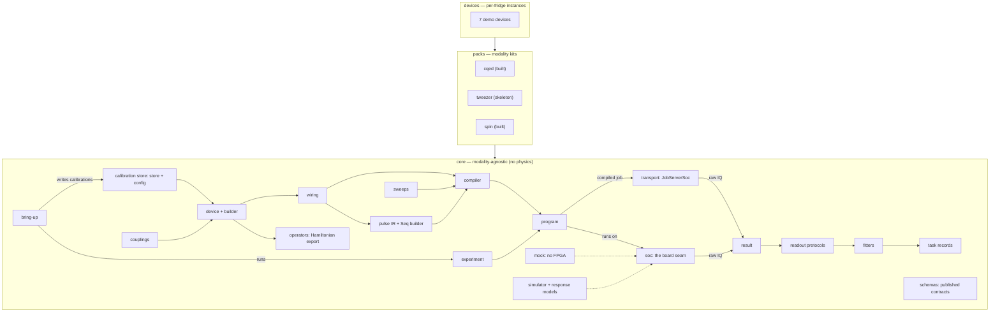

# Strumento

[](https://github.com/harmoniqs/strumento/actions/workflows/ci.yml)

**Write quantum experiments in the language of your device — run them on QICK tProc-v2.**

Strumento is a first-principles [QICK](https://github.com/openquantumhardware/qick) tProc-v2
experiment framework: a device model, a typed pulse IR, a compiler, and an experiment/fitting
lifecycle — with a raw-qick escape hatch at every level. You describe operations on *named elements*
(`dev.qubit.ge_pi()`, a gain sweep, a readout); Strumento resolves the wiring, compiles to v2, and
gives you back typed results. Nothing is walled off — when you need raw qick, it's one call away.

It's designed from first principles against the tProc-v2 API — informed by the architecture
lessons of mature tProc-v1 lab stacks, keeping the physics and discarding the legacy — and it's
built to generalize: one modality-agnostic `core`, swappable **packs** for superconducting /
neutral-atom / spin qubits.

## Quickstart

You need Python 3.10–3.12 and no board:

```bash
git clone https://github.com/harmoniqs/strumento.git && cd strumento
python3 -m venv .venv && source .venv/bin/activate
pip install -e ".[qick]"
```

Then calibrate a qubit's π pulse on the simulator, whose true π gain (9350) differs from what the
demo device believes:

```python
from strumento import Device
from strumento.core.simulator import SimulatorSoc
from strumento.packs.cqed.experiments.amplitude_rabi import AmplitudeRabi

dev = Device.load("devices/multimode_demo/device.yaml")
print(dev.calib.qubit.pulses["pi_ge"].gain)   # what the device believes the π gain is

soc = SimulatorSoc.from_device(dev, truth={"pi_gain": 9350}, seed=3)
fit = AmplitudeRabi(dev).go(soc, reps=2000, progress=False).fit
print(fit.success, f'{fit.derived["pi_gain"]:.0f} ± {fit.derived["pi_gain_stderr"]:.0f}')
```

<!-- snippet: output -->
```text
8192.0
True 9333 ± 71
```

The full walkthrough, from here to your own device and real hardware, is
**[docs/getting-started.md](docs/getting-started.md)**.

## Why Strumento

- **Model the device, not the FPGA.** Physical ops on named elements; a wiring layer maps them to
  DACs. Re-patching a cable is a one-line config edit — every experiment is untouched.
- **Typed pulses, computed from calibration.** No string keys, no `eval`. A pulse is a typed value
  from a factory that reads calibration.
- **Escape hatch everywhere.** `StrumentoProgram` *is* an `AveragerProgramV2` — splice a raw call
  mid-sequence, or hand-write a body, while still using the abstractions for everything else.
- **The pure layers need no board.** The IR, device model, builder, compiler, fitters, and job
  transport all import and unit-test with no `qick` installed.
- **A measurement *instrument*, not just a runtime.** Author a device in code or YAML, measure the
  as-built device, and export its Hamiltonian for optimal control — closing a hardware↔pulse loop.

## Status

The modality-agnostic `core` and the `cqed` pack are built and green end-to-end through the
first six tracer-bullet slices: pulses, sweeps, amplitude Rabi, T1/T2 Ramsey, f0g1 + storage
swaps, parity, resonator spectroscopy, and the optimal-control import boundary
(`from_solution`). The device model — `DeviceBuilder`, typed couplings, Hamiltonian export —
is built; the `spin` pack covers quantum-dot workflows (slow-DC seam, charge stability, PSB
readout tune-up); `tweezer` ships as a skeleton. A vendored fitter library (resonator circle
fit, Fano, the damped-sinusoid family, double-Gaussian), a `SimulatorSoc` that returns synthetic
data from a ground truth you choose, and a `strumento` CLI round it out. The suite runs offline;
most of the logic needs no `qick` at all.

> **The v2 story:** building a *real* `AveragerProgramV2` needs a **tProc-v2** (`qick_processor`)
> soccfg. The repo commits v2 configs, the official qick **testbench** (single-channel) and a
> fabricated six-generator cqed board that `multimode_demo` carries, so real v2 assembly runs
> offline and in CI. Drop your own board's `dump_cfg()` at `devices/_fixtures/soccfg_v2.json`
> and the v2 suite runs against *your* firmware instead.

**Running on a board.** Four guides take you from a new board to a calibrated qubit:
[board-bringup.md](docs/board-bringup.md) (describe and validate the device),
[write-a-runner.md](docs/write-a-runner.md) (the run script a board needs, with an example to
copy), [calibrate-a-transmon.md](docs/calibrate-a-transmon.md) (the calibration chain to
randomized benchmarking), and [getting-started.md §12–13](docs/getting-started.md#12-going-to-hardware)
(a before-every-session checklist and troubleshooting). In 0.1.0 the safeguards a run on a board
needs (a live board check, a lock, a preflight, quality checks on the fit) are a documented
procedure and an example script, not package behaviour: read the guides before an armed run.

Roadmap: 0.2.0 makes those safeguards package behaviour, behind a generic `strumento run` command
and an approval-gated MCP session on hardware (#223). Beyond it: active reset (herald/post-selection
data path, then in-sequence v2 feedback), the tweezer pack ops, spinQICK-parity long tail (see
[docs/spin-pack.md](docs/spin-pack.md)), and the codesign arc (device-model reports, board
descriptions).

### Known limitations

What 0.1.0 does **not** yet do, so nothing here surprises you on a board. Where an issue tracks
the work, it is linked.

- **The MCP session drives the simulator and the mock only.** `load_device` offers
  `soc="simulator"` and `soc="mock"`; there is no hardware soc kind yet (#83, #202). Hardware runs
  go through the Python API (`Experiment.go` against a live soc). Any agent-driven work on a board
  should be **human-attended**: a run can't yet be aborted or timed out, and two sessions on one
  store ref aren't serialized (#197).
- **Shot-based experiments need a soc that returns per-shot data.** `active_reset`,
  `readout_state`, `single_shot_readout`, `validation_check` and spin `heralded_init` declare
  `needs_shots`. On a result without shots they refuse with an explicit reason rather than fit
  averages. Only `SimulatorSoc` provides shots today; a hardware shot path is #199. A caller that
  reads per-shot data from the board itself and passes a result with `shots` set analyses as usual.
- **The board's live config is not checked against the device's soccfg snapshot.** Gains and
  pulse timing are computed from the committed snapshot; if the board's firmware differs
  (`maxv`, `fs`, tProc revision), programs still compile but play differently (#198). Capture your
  board's snapshot (`dump_cfg()`) and keep it current. The example run script in
  [docs/write-a-runner.md](docs/write-a-runner.md) compares the two on every run and refuses on a
  difference; the package itself does not yet.
- **No device lock, preflight or fit-quality gate in the package.** `Experiment.go` against a live
  soc runs one experiment; it does not lock the board, check the compiled program before playing
  it, or judge the fit beyond "the fitter converged". The example run script shows all three; the
  package version is #223.
- **Generator lookups assume each generator's tProc port equals its list position.** That holds on
  every shipped fixture; on a board where they differ, full-scale gain and DAC rate can come from
  the wrong generator (#149). `strumento check` validates the wiring by list position.
- **The coupler pump and the sideband drive have no per-element gain limit.** The qubit drive,
  readout probe and cavity displacement limits can be raised per element, up to a hard cap
  ([getting-started.md, Raising a limit](docs/getting-started.md#raising-a-limit)); the coupler
  and sideband limits are fixed at 0.5 of full scale. Past them, the only way is a hand-built
  `Pulse`, which nothing checks.
- **The spin pack's limits are not hardware-hardened.** Its gain limit is full scale, voltage
  limits are per gate only (no ramp-rate or neighbouring-gate limits), and its ceilings are not
  guarded against writes over MCP the way the cqed ceilings are. Review
  [docs/spin-pack.md](docs/spin-pack.md) and set conservative per-device limits before a cool-down.
- **A store advanced by the cqed bring-up campaign can't be reopened with `load_device`.** Its
  write-back records keys the cqed calibration schema doesn't declare (`qubit.freq_correction`,
  `readout.power`, `readout.max_power`), so the reopened config fails validation. Re-tune with the
  individual experiments in the meantime
  ([docs/calibrate-a-transmon.md](docs/calibrate-a-transmon.md)).
- **A fit can report success on a trace with no signal.** The amplitude-Rabi fit, given data with
  no oscillation, converges at its starting guesses with undefined standard errors (#230). Check
  the data for a signal before trusting `fit.success`, as the example run script does.
- **Two device-file mistakes pass `strumento check`.** A device without `readout.phase` validates
  and checks but fails every experiment at compile time (#227): set `phase: 0.0`. And a calibrated
  frequency outside its generator's declared Nyquist zone is not flagged; the tone still plays, with
  less output power than intended (#226).
- **The simulator models each experiment separately.** Its response models are phenomenological:
  each reads its own ground-truth keys, so correcting one quantity does not change what another
  experiment's model sees; blob-anchored experiments place shots on the recorded blob centres; the
  AllXY response is a near-ideal staircase; and the randomized-benchmarking response is a
  placeholder that decays the wrong way (#233). It proves that experiments build, compile, acquire
  and fit; it does not validate device physics.

## Documentation

| Doc | What's in it |
|---|---|
| **[architecture.md](docs/architecture.md)** | The design: tenets, three layers, every seam, and the decision index (D1–D37) code docstrings cite. |
| **[getting-started.md](docs/getting-started.md)** | Start here: install, a first calibration on the simulator, sweeps and safety limits, the calibration store, describing your own device, and going to hardware. |
| **[board-bringup.md](docs/board-bringup.md)** | Bring up a new board: record its description, describe and wire the device, first calibration values, compare the live board with the stored description, signal-chain checks, and a simulator rehearsal. |
| **[write-a-runner.md](docs/write-a-runner.md)** | Write your own run script for hardware: compare the live board with its description, lock it, preflight what will be played, record the run, judge the fit, propose (never write) the calibration edit. With an example script to copy. |
| **[calibrate-a-transmon.md](docs/calibrate-a-transmon.md)** | Calibrate a transmon from first estimates to randomized benchmarking: each step's measurement, how to judge it, the calibration edit it makes, and the traps (an aliased Ramsey, stale readout centres, a free RB asymptote). Runs on the simulator. |
| **[cqed-cookbook.md](docs/cqed-cookbook.md)** | The `cqed` pack's API by example: pulses, sequences, sweeps, couplings, Hamiltonian export and the experiments, by category. Every snippet runs in the docs test. |
| **[packs-and-devices.md](docs/packs-and-devices.md)** | How elements compose into a device, the `DeviceBuilder`, typed couplings + Hamiltonian export, and **how to add a modality pack**. |
| **[timeline.md](docs/timeline.md)** | The cursor model — exactly when each op plays — plus the QICK-v2 redundancy audit. |
| **[calibration-store.md](docs/calibration-store.md)** | Operating a device over time — immutable, content-addressed calibration versions + write-back. |
| **[fitters.md](docs/fitters.md)** | The vendored fitter library — the resonator circle fit and friends. |
| **[interop.md](docs/interop.md)** | Importing data from other control stacks (QUA/OPX, Qblox, Zurich, a VNA, CSV) into a `MeasurementResult`, and exporting optimal-control waveforms to them. |
| **[spin-pack.md](docs/spin-pack.md)** | Quantum-dot workflows: the slow-DC seam, charge stability, PSB — and the coverage roadmap. |
| **[job-manager.md](docs/job-manager.md)** | How Strumento reaches a remote/shared board — the job server and the compile-off-board wire contract. |
| **[hardware-ci.md](docs/hardware-ci.md)** | Board-in-the-loop CI: the runner-on-the-board pattern and how to stand one up. |
| **[cli.md](docs/cli.md)** | The `strumento` CLI (agent-forward; `--json` everywhere). |
| **[qick-v2-api-notes.md](docs/qick-v2-api-notes.md)** | The exact offline qick tProc-v2 API Strumento builds against. |
| **[AGENTS.md](AGENTS.md)** | Orientation for AI agents: rules, recipes, what needs a board. |
| **[CHANGELOG.md](CHANGELOG.md)** | What each release contains, newest first. |

## Architecture

Three layers. Inside `core`, arrows show data flow: what feeds into what. Between the three
layers, dependencies point down: packs depend on `core`, and devices instantiate packs. Dotted
arrows mark the implementations of the `soc` board seam. Only `strumento/core/program.py` and
`strumento/core/mock.py` import qick. The simulator reaches it through the mock, and the packs and
`interop` never import it.



- **`core`** — modality-agnostic mechanism. A device is built from a stored config and its
  couplings; it exports a Hamiltonian and supplies the wiring that pulses and the compiler resolve
  against. The compiler lowers the pulse IR and sweeps into a program, which runs on a soc (a real
  board, the no-FPGA mock, or the simulator) or ships as a compiled job over the transport. The
  raw IQ becomes a result; readout protocols reduce it and fitters fit it, and the experiment
  writes a task record. Bring-up chains experiments and writes calibrations back to the store. The
  schemas publish the wire forms (device config, fit, result, operator model) as JSON Schema.
- **`packs`** — one reusable kit per physics class (element types + libraries + readout kind + calib
  schema), discovered via the `strumento.packs` entry-point group. A new pack is a new directory,
  not a core change.
- **`devices`** — one instance per physical fridge (topology + wiring + calibration values).

## Repository layout

```
strumento/
  strumento/
    core/         wiring · pulses · sweeps · device · builder · config · store · coupling ·
                  operators · compiler · program · soc · mock · simulator · response ·
                  transport · legacy_pyro_runner · result · readout · fitters ·
                  resonator_fitters · experiment · record · bringup · schemas · environment ·
                  dc · datachest · display · tracing
    cli.py        stateless CLI (strumento check / validate / schema / …)
    mcp.py        stateful MCP lab session (D33)
    packs/
      cqed/       elements · calibration · couplings · library/ · readout · experiments/
                  bringup · responses · safety · tomography · plot              (built)
      tweezer/    elements · calibration · envelopes · readout                  (skeleton)
      spin/       elements · calibration · library/ · readout · experiments/
                  bringup · host_bridge · responses · safety · plot             (built)
    interop/      backends · piccolo  — multi-backend data import + upstream bridges
  devices/
    multimode_demo/   device.yaml                     (cqed instance)
    loopback_demo/    device.yaml                     (cqed instance)
    spin_demo/        device.yaml                     (spin instance)
    spin_eo_demo/     device.yaml                     (spin instance)
    spin_hole_demo/   device.yaml                     (spin instance)
    spin_st_demo/     device.yaml                     (spin instance)
    tweezer_demo/     device.yaml                     (tweezer instance)
    _fixtures/        soccfg snapshots, used by multimode_demo · loopback_demo · spin_demo
  docs/           architecture · getting-started · cqed-cookbook · packs-and-devices · cli · …
  tests/          core/ · packs/ · interop/ · e2e/
```

## Where it fits in the Harmoniqs stack

Strumento sits between the pulse layer and the hardware. Above it, Piccolo designs pulses and
Intonato tunes them closed-loop against the device; below it, QICK runs the compiled program on
the RFSoC board that drives the device. Strumento knows nothing about calibration *strategy*: it
takes a pulse, compiles it, acquires, and reduces the data to a measurement vector.

```
Piccolo / Intonato  →  optimal-control pulses · closed-loop tuning (Julia)
        │                 reached through Strumento.jl, the Julia binding, or the Python API
    strumento       →  from_solution → compile → acquire → reduce   ← this repo
        │
      QICK          →  tProc-v2 firmware and the qick library, on the RFSoC board
        │
     device         →  the qubits, wired to the board's DACs and ADCs
```

- [Piccolo.jl](https://github.com/harmoniqs/Piccolo.jl): quantum optimal control by direct
  trajectory optimization.
- [Intonato.jl](https://github.com/harmoniqs/Intonato.jl): closed-loop pulse tuning against an
  experiment in the loop, built on Piccolo.
- [Strumento.jl](https://github.com/harmoniqs/Strumento.jl): the Julia face of this package; it
  hands a solved pulse to `strumento` and reads measurements back.
- [QICK](https://github.com/openquantumhardware/qick): the open-source RFSoC firmware and library
  strumento compiles to.

Optimal-control pulses enter through `from_solution`; the reverse seam,
`dev.to_operator_model(...)`, exports the device Hamiltonian for a solver — closing the codesign
loop.

## Install & develop

Strumento supports **Python 3.10–3.12**. The pure layers need only `pydantic` / `numpy` / `scipy` /
`lmfit` / `pyyaml`; the `qick` extra (pinned to `qick>=0.2.367,<0.3`) adds the compiler, program,
mock and simulator.

```bash
pip install -e ".[test]"          # pure layers + pytest
pip install -e ".[test,qick]"     # + the qick-facing layers (installs off-board on x86, no pynq)
pip install -e ".[qick,plot]"     # + matplotlib, for display=True figures

pytest -m "not qick"              # the pure layers, no board
pytest                            # everything (v2-only tests skip without a tProc-v2 soccfg)
```

The extras are listed in [docs/getting-started.md](docs/getting-started.md#1-what-you-need);
[CONTRIBUTING.md](CONTRIBUTING.md) has the test lanes CI runs.

## Naming

*Strumento* is Italian for **instrument** — QICK is the *Instrumentation* Control Kit, and Strumento
is the instrument you play it with. It joins the Harmoniqs family of Italian-musical names; we
avoided a `*QICK` name so it reads as *our layer on QICK*, not a fork.

## License

MIT — see [LICENSE](LICENSE).
