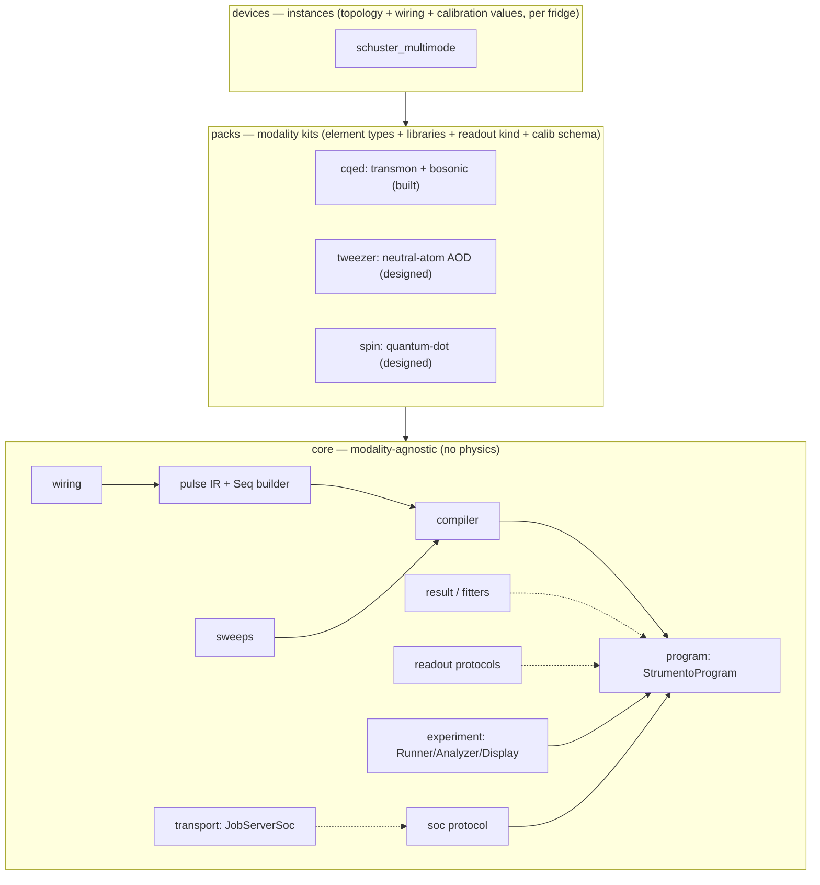

# Strumento

**A first-principles [QICK](https://github.com/openquantumhardware/qick) tProc-v2 experiment framework** — device model, pulse IR, compiler, and experiment/fitting lifecycle, with a raw-qick escape hatch at every level.

Strumento lets you describe a quantum experiment in the language of your **device** —
`dev.qubit.ge_pi()`, a gain sweep, a readout — compose it with a fluent builder, and run it on
QICK's tProc **v2**, without ever hand-writing register-level assembly. When you *do* need raw
qick, it is reachable at every level: nothing is walled off.

It is a ground-up redesign of the core functionality of Stanford's
[`SchusterLab/multimode_expts`](https://github.com/SchusterLab/multimode_expts) (a tProc-**v1**
codebase) — keeping the physics, discarding the architecture — built to generalize beyond one
device: the same `core` serves superconducting, neutral-atom, and spin-qubit labs through
swappable **modality packs**.

> **Private for now.** Strumento is developed openly in intent but kept private until the core is
> proven; it will be open-sourced.

---

## Status

| Layer | State |
|---|---|
| `core` — wiring, pulse IR, sweeps, device, compiler, result, fitters, readout, experiment, soc, **transport** | ✅ built |
| `cqed` pack — element types, calibration schema, `TransmonOps`, `DispersiveIQ`, `AmplitudeRabi` | ✅ built |
| `core` qick-facing — `MockQickSocV2`, `StrumentoProgram` | ✅ built |
| Slices 3–6 (T1/T2, f0g1/swap, parity, optimal-control import) · `tweezer`/`spin` packs | ⏳ roadmap |

Two slices are green end-to-end: **Slice 1** (a pulse compiles onto the mock) and **Slice 2**
(amplitude Rabi — sweeps + fitting). The full test suite runs offline; ~95% of the logic needs no
`qick` and no board.

> **One gate to note.** Building a *real* `AveragerProgramV2` needs a **tProc-v2** (`qick_processor`)
> soccfg. The committed Schuster snapshot is tProc-**v1**, so the handful of tests that assemble a
> real v2 program are skip-gated until a v2 `dump_cfg()` is dropped at
> `devices/_fixtures/soccfg_v2.json`. Everything else — building sequences, compiling (verified
> against a recording program), fitting, the transport contract — runs today.

## Design goals

- **Model the device, not the FPGA.** You write physical operations on named elements; a wiring
  layer maps them to DACs. Re-patching a cable is a one-line config edit — every experiment is
  untouched.
- **Typed pulses, computed from calibration.** No string keys, no `eval`, no positional
  descriptors. A pulse is a typed value produced by a factory function that reads calibration.
- **One source of truth.** Every physical quantity lives in exactly one place; nothing derived is
  stored; adding a pulse type is one edit.
- **Escape hatch everywhere (Tenet 0).** `StrumentoProgram` *is* an `AveragerProgramV2`. Splice a
  raw qick call mid-sequence, hand-write a program body, or drop to the bare API — while still
  using the abstractions for everything else.
- **The pure layers need no board.** The IR, wiring, device model, compiler, sweeps, fitters,
  readout kinds, and the job transport all import and unit-test with no `qick` installed.
- **A measurement instrument, not just a runtime.** Strumento can be authored from a design-time
  device model, measure the as-built device, and export the measured model plus a design-vs-measured
  diff — so it closes a hardware ↔ pulse codesign loop rather than only playing pulses one way.

## Install

Strumento targets **Python 3.11+**. The pure layers need only `pydantic` / `numpy` / `scipy` /
`lmfit` / `pyyaml`; `qick` (with `qick.asm_v2`) is an optional extra used by the compiler / program
/ mock.

```bash
pip install -e ".[test]"          # pure layers + pytest
pip install -e ".[test]" qick     # + the qick-facing layers (installs off-board on x86 — no pynq)
```

## Quickstart

```python
from strumento import Device, Seq, Sweep

# 1. Load a device instance (topology + wiring + calibration values).
dev = Device.load("devices/schuster_multimode/device.yaml")

# 2. Build pulses in device language — computed from calibration, returned as typed values.
pi = dev.qubit.ge_pi()                 # a π pulse on the g–e transition
print(pi.freq_mhz, pi.gain, pi.envelope)
# 3562.6105  0.10037844…  Gaussian(sigma_us=0.035)
#            ^ a v2 fraction: the calib int code 3289 / maxv 32766 (converted at the pack boundary)

# 3. Compose a sequence with the fluent builder.
seq = Seq().play(dev.qubit.ge_pi()).wait(0.5).measure()

# 4. Amplitude Rabi: a gain sweep is just a value in the pulse.
#    Sweep in lab-native int codes; the factory maps them to a fraction sweep for the hardware
#    while keeping the int-code axis for your plots (result.xpts).
amp = Sweep("amp", 0, 30000, 51)
rabi = Seq().play(dev.qubit.ge_pi(gain=amp)).measure()
```

Running it on hardware (or the offline mock) goes through `StrumentoProgram`:

```python
from strumento.core.program import StrumentoProgram
from strumento.core.mock import MockQickSocV2                     # qick-facing

soc = MockQickSocV2.from_snapshot("devices/_fixtures/soccfg_v2.json")   # a tProc-v2 dump_cfg()
prog = StrumentoProgram(dev, seq=rabi, reps=1000, soc=soc)
result = prog.acquire(soc)                                        # -> MeasurementResult
xpts, avgi, avgq = result.as_tuple()                              # xpts is the 0..30000 int-code axis
```

> `StrumentoProgram` builds a real `AveragerProgramV2`, so it needs a tProc-v2 soccfg (the `.[qick]`
> extra + a v2 `dump_cfg()` at `devices/_fixtures/soccfg_v2.json`). Sequence building, compilation,
> and analysis all work without one.

The high-level way to run a characterization is an **experiment**, which pairs the sequence with a
fit:

```python
from strumento.packs.cqed.experiments.amplitude_rabi import AmplitudeRabi

outcome = AmplitudeRabi(dev, gains=Sweep("amp", 0, 30000, 51)).go(soc)
print(outcome.fit.derived["pi_gain"])     # the drive amplitude for a π rotation
```

## Concepts

### Device & wiring — *model the device, not the FPGA*

A **device instance** is a YAML file: a topology of named elements, the wiring that maps each
element's lines to DAC channels, and calibration values. `Device.load` composes it into a live
`Device`; the element names become namespaces:

```python
dev = Device.load("devices/schuster_multimode/device.yaml")
dev.qubit                    # a TransmonOps, bound because the YAML names a transmon "qubit"
dev.wiring.resolve(LineRef("qubit", "drive"), freq_mhz=3562).dac_ch   # -> 2
```

`dev.qubit` exists because *this instance* names its transmon `qubit`; a different YAML yields
`dev.q0` / `dev.cavity`. No instance name is hardcoded in the pack. Re-patching a cable is a wiring
edit — the pulse factories and experiments, which speak only device language, are untouched.

### Typed pulses, computed from calibration

Pulses are produced by factory methods on an element's ops, reading calibration — not looked up
from a string-keyed bank:

```python
dev.qubit.ge_pi()                 # from calib
dev.qubit.ge_pi(phase=90)         # override the phase
dev.qubit.ge_hpi()                # a π/2
dev.qubit.ef_pi()                 # the e–f transition (uses f_ef)
```

Every pulse carries a **typed envelope** — `Gaussian` / `FlatTop` / `Const` / `Arb` (frozen
dataclasses; packs register more). The gain a factory returns is a **v2 fraction**: the calibration
stores lab-native int codes, and the cqed factory converts them at the pack boundary, so the
compiler never sees an int code.

### Sequences — the fluent builder

```python
seq = (Seq()
       .play(dev.qubit.ge_pi())
       .wait(0.5)                                  # µs
       .raw(lambda p: p.delay_auto(0.01))          # drop to raw qick, then keep going
       .measure())
```

`.play` also flattens a sub-`Seq`, and `.play_parallel([...])` plays pulses simultaneously.

### Sweeps — values, not a separate axis object

A `Sweep` can stand in for any pulse field. It carries a **lab-native display axis**: a gain sweep
in int codes becomes a fraction sweep for the compiler, but `result.xpts` reports the original int
codes so your notebook reads in familiar units.

```python
amp = Sweep("amp", 0, 30000, 51)          # lab-native int codes
p = dev.qubit.ge_pi(gain=amp)
p.gain.start, p.gain.stop                 # 0.0, 0.915…  (fraction, for the hardware)
p.gain.xpts[-1]                           # 30000        (kept for plotting)
```

The compiler lowers a swept field to one `add_loop` + a `QickSweep1D`, and rejects a frequency
sweep that would cross a generator's band boundary.

### Fitters & readout kinds

Fitters are `lmfit`-backed and return a typed `FitResult` (params + stderr + derived physics) — no
printing, no plots:

```python
from strumento.core.fitters import fit_rabi
fit = fit_rabi(xpts, signal)
fit.derived["pi_gain"], fit.derived["period"]
```

A **readout kind** turns raw data into physics. The cqed `DispersiveIQ` rotates the IQ cloud,
thresholds per shot, and reduces to a population:

```python
from strumento.packs.cqed.readout import DispersiveIQ
disc = DispersiveIQ(threshold=0.0, angle=0.3)
disc.discriminate(iq)     # per-shot 0/1
disc.reduce(iq)           # excited-state population
```

Readout is a protocol seam (`core/readout.py`) so a different modality (e.g. tweezer fluorescence
imaging) slots in without touching `core`.

### Experiments — acquire / analyze / display, separated

`Experiment` keeps the high-level `go()` but separates the internals: a **Runner** (build + acquire),
an **Analyzer** (`analyze` → `FitResult`), and a **Display** (`display` → figure). The Runner is
injectable, so the lifecycle is testable without a board.

### The board seam — soc + transport (no Pyro)

Strumento abstracts the board behind a small **soc protocol** (`AbstractSoc`): a `MockQickSocV2`, a
real board's `QickSoc`, or a simulator all satisfy it. Above that, a **transport** ships work to a
remote board. The `JobServerSoc` transport is *job-server-native*: it submits a coarse
`CompiledJob` (an overlay id + the compiled program + acquisition config) and gets back a
`RawAcquisition` — one job in, IQ out — rather than proxying every call. Swapping the board, or the
transport to it, changes nothing above this seam.

```python
from strumento.core.transport import CompiledJob, JobServerSoc
raw = JobServerSoc(client).run(job)          # submit + poll-to-done + deserialize
result = raw.to_measurement_result(xpts)
```

## Architecture

Three layers. Dependency arrows point down; only the compiler, program, and mock touch qick.



- **`core`** — modality-agnostic. Wiring; the typed pulse IR (an envelope union extended by packs);
  sweeps; the fluent `Seq` builder; the compiler + `StrumentoProgram`; the typed
  `MeasurementResult`; generic `lmfit` fitters; the experiment scaffold; the no-FPGA mock; and the
  soc + transport seams plus read-only protocols for readout kinds and station telemetry.
- **`packs`** — one reusable kit per physics class. Discovered via the `strumento.packs` entry-point
  group, so third-party packs install rather than fork. Shipped: **`cqed`**. Designed:
  **`tweezer`**, **`spin`**.
- **`devices`** — one *instance* per physical fridge. "Multimode" is a `cqed` instance; a
  pure-transmon chip is another topology of the same pack.

### Repository layout

```
strumento/
  strumento/                 # the importable package
    core/                  # wiring · pulses · sweeps · device · compiler · program · result ·
                           #   readout · experiment · fitters · mock · soc · transport
    packs/
      cqed/                # elements · calibration · library/ · readout · experiments/
  devices/
    schuster_multimode/    # device.yaml + soccfg snapshot (config)
  tests/                   # core/ · packs/cqed/ · e2e/
  docs/
    spec.md                # design of record
    plan.md                # implementation plan (slices 1–6)
    getting-started.md     # walkthrough with examples
    qick-v2-api-notes.md   # the offline qick tProc-v2 API surface
```

## Where it sits in the Harmoniqs stack

Strumento is the **open measurement/execution substrate at the bottom of the closed-loop
calibration stack**. It knows nothing about calibration *strategy* — it imports a pulse, compiles
it, acquires, and reduces to a measurement vector. The calibration method lives above it.

```
Intonatissimo   →  calibration method (private)
  Intonato       →  strategy-generic calibration chassis
    IntonatoQICK →  hardware backend (upload / trigger / readout)
      strumento    →  from_solution → compile → acquire → reduce   ← this repo
        board
```

Optimal-control pulses from the Harmoniqs stack enter through a single typed seam,
`from_solution(...)` (Slice 6), which maps solved drives onto device lines, resamples to the DAC
grid, calibrates physical amplitude to gain, and carries provenance.

## Roadmap

The [plan](docs/plan.md) delivers `core` + the `cqed` pack across six vertical tracer-bullet slices,
each end-to-end and independently demoable:

1. ✅ **Skeleton** — one pulse, one readout, compiled onto the mock. *Proves the whole vertical.*
2. ✅ **Amplitude Rabi** — sweeps as values + fitting.
3. ⏳ **T1 + T2 Ramsey** — swept delays and phase.
4. ⏳ **f0g1 + storage swap** — the multi-line device model (`dev.sideband.f0g1()`,
   `dev.coupler.swap(...)`).
5. ⏳ **Parity** — composite factories (`dev.parity(...)`).
6. ⏳ **Optimal-control import** — the Piccolo × QICK seam (`from_solution`).

Also built alongside the slices: the **soc + `JobServerSoc` transport** seam (no-Pyro,
compile-off-board). Deferred: in-sequence measurement feedback (active reset), the `tweezer` /
`spin` packs, and config-versioning.

## Development

Development follows the plan task-by-task with a `pytest` TDD cycle (write the failing test,
implement, green, commit).

```bash
pytest -m "not qick"    # the pure layers — no board / no qick
pytest -m qick          # compiler / program / mock (needs qick with qick.asm_v2)
pytest                  # everything (v2-only tests skip without a tProc-v2 soccfg)
```

Markers: `pure` (no qick), `qick` (needs the qick library), `oracle` (cross-checks against the
legacy v1 `fitting.py`).

## Naming

*Strumento* is Italian for **instrument** — QICK is the *Instrumentation* Control Kit, and
Strumento is the instrument you play it with: the experiment framework that sits on top. It joins
the Harmoniqs family of Italian-musical package names. We deliberately avoided a `*QICK` name so the
framework reads as *our layer on QICK* rather than a fork of it.

## License

Open-source license to be finalized before the first public release.
