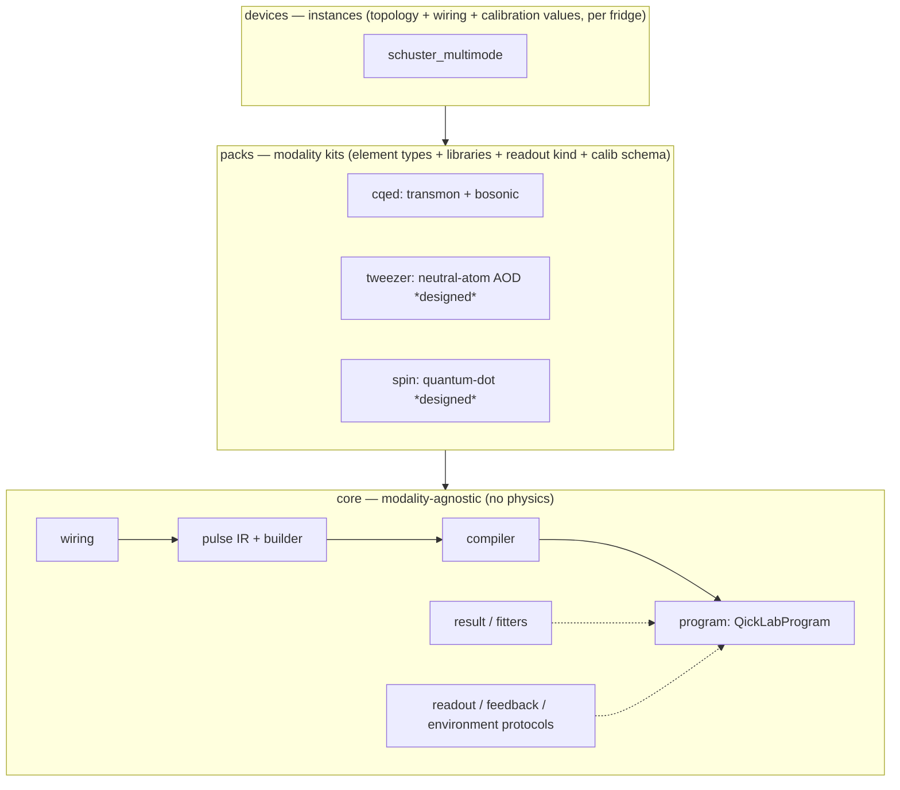

# qicklab

**A first-principles [QICK](https://github.com/openquantumhardware/qick) tProc-v2 experiment framework** — device model, pulse IR, compiler, and experiment/fitting lifecycle, with a raw-qick escape hatch at every level.

> **Status: design phase.** This repository currently houses the design of record — the [specification](docs/spec.md) and the [implementation plan](docs/plan.md). Code lands incrementally as the tracer-bullet slices in the plan turn green. The package tree below is the target structure; most modules are not yet implemented.
>
> **Private for now.** qicklab is being developed openly in intent but kept private until the core is proven and a naming/partnership conversation with the QICK collaboration has happened.

---

## What it is

qicklab lets you describe a quantum experiment in the language of your **device** — `dev.qubit.ge_pi()`, `dev.sideband.f0g1()`, `dev.coupler.swap("M1-S3")` — compose it with a fluent builder, and run it on QICK's tProc **v2**, without ever hand-writing register-level assembly. When you *do* need raw qick, it is reachable at every level: nothing is walled off.

It is a ground-up redesign of the core functionality of Stanford's [`SchusterLab/multimode_expts`](https://github.com/SchusterLab/multimode_expts) (a tProc-**v1** codebase) — keeping the physics, discarding the architecture. It is built to generalize beyond one device: the same `core` serves superconducting, neutral-atom, and spin-qubit labs through swappable **modality packs**.

### Design goals

- **Model the device, not the FPGA.** You write physical operations on named elements; a wiring layer maps them to DACs. Re-patching a cable is a one-line config edit — every experiment is untouched.
- **Typed pulses, computed from calibration.** No string keys, no `eval`, no positional descriptors. A pulse is a typed value produced by a factory function that reads calibration.
- **One source of truth.** Every physical quantity lives in exactly one place; nothing derived is stored; adding a pulse type is one edit.
- **Escape hatch everywhere (Tenet 0).** `QickLabProgram` *is* an `AveragerProgramV2`. You can splice a raw qick call mid-sequence, hand-write a program body, or drop to the bare API — while still using the abstractions for everything else.
- **The pure layers need no board.** ~70–80% of the logic (IR, wiring, sweeps, builder, fitters) is importable and unit-testable with no qick installed.

## Quickstart *(target API — not yet implemented)*

```python
from qicklab import Device, Seq, Sweep, QickLabProgram
from qicklab.core.mock import MockQickSocV2

dev = Device.load("devices/schuster_multimode/device.yaml")

# Amplitude Rabi: a gain sweep is just a value in the pulse.
amp = Sweep("amp", 0, 30000, 51)
prog = QickLabProgram(
    dev, reps=1000, sweeps=[amp],
    seq=Seq().play(dev.qubit.ge_pi(gain=amp)).measure(),
)
result = prog.acquire(MockQickSocV2())     # -> MeasurementResult

# A richer sequence, with a raw-qick escape hatch mid-flight:
seq = (Seq()
    .play(dev.qubit.ge_pi())
    .play(dev.sideband.f0g1())
    .play(dev.coupler.swap("M1-S3", phase=180))
    .play(dev.parity(mode="manipulate"))       # a composite sub-sequence
    .raw(lambda p: p.delay_auto(0.01))         # drop to raw qick, then keep going
    .measure())
```

## Architecture

Three layers. Dependency arrows point down; only the compiler, program, and mock touch qick.



- **`core`** — modality-agnostic. Wiring, the typed pulse IR (a compact envelope union: `Gaussian`/`FlatTop`/`Const`/`Arb`, extended by packs), sweeps, the fluent `Seq` builder, the compiler + `QickLabProgram`, the typed `MeasurementResult`, generic `lmfit` fit primitives, a no-FPGA mock, and read-only protocols for readout kinds, feedback, and station/fridge telemetry.
- **`packs`** — one reusable kit per physics class: element *types*, pulse libraries, the readout *kind*, experiment types, and a calibration *schema*. Shipped: **`cqed`** (superconducting transmon + bosonic). Designed: **`tweezer`** (neutral-atom AOD) and **`spin`** (quantum-dot). Discovered via the `qicklab.packs` entry-point group, so third-party packs install rather than fork.
- **`devices`** — one *instance* per physical fridge: a topology of elements + wiring (line/generator → DAC) + calibration values. "Multimode" is a `cqed` *instance*; a pure-transmon chip is another topology of the same pack.

### Repository layout

```
qicklab/
  qicklab/                 # the importable package
    core/                  # wiring · pulses · sweeps · device · compiler · program ·
                           #   result · readout · feedback · environment · fitters · mock
    packs/
      cqed/                # elements · calibration · library/ · readout · experiments/
  devices/
    schuster_multimode/    # device.yaml + swap datasets + soccfg snapshot (config)
  tests/                   # core/ · packs/cqed/ · e2e/
  docs/
    spec.md                # design of record
    plan.md                # implementation plan (slices 1–6)
```

## Where it sits in the Harmoniqs stack

qicklab is the **open measurement/execution substrate at the bottom of the closed-loop calibration stack**. It knows nothing about calibration *strategy* — it imports a pulse, compiles it, acquires, and reduces to a measurement vector. The calibration method lives above it.

```
Intonatissimo   →  calibration method (private)
  Intonato       →  strategy-generic calibration chassis
    IntonatoQICK →  hardware backend (upload / trigger / readout)
      qicklab    →  from_solution → compile → acquire → reduce   ← this repo
        board
```

Optimal-control pulses from the Harmoniqs stack (Piccolo / Piccolissimo) enter through a single typed seam, `from_solution(...)`, which maps solved drives onto device lines, resamples to the DAC grid, calibrates physical amplitude to gain, and carries provenance.

## Roadmap

The [plan](docs/plan.md) delivers `core` + the `cqed` pack across six vertical tracer-bullet slices, each end-to-end (device → factory → sequence → compile → mock-acquire → result → fit) and independently demoable:

1. **Skeleton** — one pulse, one readout, compiled onto the mock. *Proves the whole vertical.*
2. **Amplitude Rabi** — sweeps as values + fitting.
3. **T1 + T2 Ramsey** — swept delays and phase.
4. **f0g1 + storage swap** — the multi-line device model.
5. **Parity** — composite factories.
6. **Optimal-control import** — the Piccolo × QICK seam (`from_solution`).

Deferred to later work: in-sequence measurement feedback (active reset), the `tweezer` and `spin` packs, job-server integration, and config-versioning.

## Development

```bash
pip install -e ".[dev,qick]"     # pure layers work without the qick extra
pytest -m pure                    # no board / no qick
pytest -m qick                    # compiler / program / mock (needs qick with qick.asm_v2)
```

Development follows the plan task-by-task with a `pytest` TDD cycle (write the failing test, implement, green, commit). See [docs/plan.md](docs/plan.md).

## Naming

`qicklab` is a working name chosen to sit close to the QICK ecosystem. It is not final, and a rename is on the table once the QICK-collaboration/partnership conversation has happened.

## License

To be determined before any public release.
