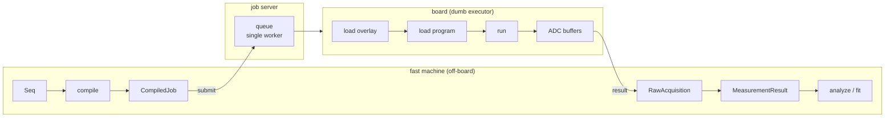

# The job manager

How Strumento talks to a board when the board is remote or shared: a **job server** (a.k.a. the job
manager) that Strumento reaches through a coarse transport, `JobServerSoc`. This is the resolved D14
design — *job-server-native, no Pyro* (spec §14.2).

## The model — compile off-board, run on a dumb executor

The work splits cleanly across two machines:

- **The fast machine** (your PC) owns everything expensive: build the sequence, **compile** it to a
  tProc-v2 program, and later **analyze/fit** the results. All of this is offline — no board.
- **The board** is a **dumb executor**: *load a firmware overlay → load the compiled program → run
  → return ADC buffers.* Nothing more.

That split is what `QickConfig.dump_cfg()` unlocks: once the whole build+compile of an
`AveragerProgramV2` happens off-board, the only board-side operation left is coarse — one job in,
raw IQ out. That's a **job submission**, not a live object proxy, so there is **no Pyro**: Pyro
exists to proxy fine-grained remote method calls, exactly the thing this design removes (and Pyro4
is EOL besides).



## Two seams — don't confuse them

Strumento has two distinct board-facing abstractions:

| Seam | What it is | Implementations |
|---|---|---|
| **`AbstractSoc`** (`core/soc.py`) | the board *object* the acquire loop drives, method-by-method | `MockQickSocV2`, a real `QickSoc`, `SimulatorSoc`, or the thin on-board agent's *local* soc |
| **`Transport`** (`core/transport.py`) | the off-board→board *channel* | `JobServerSoc` |

An `AbstractSoc` lives *at* the board (in-process for the mock/sim; on the board's ARM for the thin
execute-agent). A `Transport` is how the fast machine *reaches* a remote board. Swapping the board,
or the transport to it, changes nothing above these seams — which is exactly why dropping Pyro is a
one-line implementation swap.

## The wire contract

Two dataclasses cross the wire (`core/transport.py`):

- **`CompiledJob`** — what you submit: `overlay_id` (which firmware personality), `program` (the
  compiled tproc binary + envelopes, opaque to the transport), and `acquire` (run parameters:
  `reps`, `soft_avgs`, `ro_chs`, `reads_per_shot`, `expts`).
- **`RawAcquisition`** — what comes back: per-readout-channel IQ arrays. `.to_measurement_result(xpts)`
  wraps it into the same `MeasurementResult` the in-process path returns.

The transport itself treats `program` as an opaque blob — it just ships it; the board agent knows
how to load it. That keeps the contract stable regardless of how the program is compiled.

The job server's API is a tiny protocol, `JobServerClient` — `submit(job_wire) -> job_id` and
`poll(job_id) -> status`. The HTTP (or other) wiring lives in the **deployment**, not in Strumento
core; an in-process client makes the whole path testable with no server and no board.

## Example

```python
from strumento.core.transport import CompiledJob, JobServerSoc

# a compiled job (the program blob comes from compiling a StrumentoProgram off-board)
job = CompiledJob(
    overlay_id="cqed-multimode-v2",
    program={"blob": "<compiled tproc binary + envelopes>"},
    acquire={"reps": 1000, "soft_avgs": 1, "ro_chs": [0], "reads_per_shot": [1], "expts": 51},
)

soc = JobServerSoc(client)          # client implements JobServerClient (submit / poll)
raw = soc.run(job)                  # submit -> poll-to-done -> deserialize  (one job in, IQ out)
result = raw.to_measurement_result(xpts=amp_axis)    # -> MeasurementResult
```

`JobServerSoc.run` is deliberately coarse: submit once, poll to completion, deserialize — **not** a
per-call proxy. A failed job raises `JobError`.

### Testing without a server

Because `JobServerClient` is a plain protocol, an in-process fake drives the whole transport in a
unit test — no HTTP, no board:

```python
import numpy as np

class FakeJobServer:                       # implements JobServerClient
    def __init__(self): self._jobs = {}; self._n = 0
    def submit(self, job_wire):
        jid = str(self._n); self._n += 1
        acq = job_wire["acquire"]; expts = acq.get("expts")
        iq = [np.zeros((nr, 2) if expts is None else (nr, expts, 2)).tolist()
              for nr in acq["reads_per_shot"]]
        self._jobs[jid] = {"status": "done", "acquisition": {"iq": iq}}
        return jid
    def poll(self, jid): return self._jobs[jid]

raw = JobServerSoc(FakeJobServer()).run(job)
np.asarray(raw.iq[0]).shape        # (1, 51, 2)  — (n_readouts, n_expts, IQ)
```

## Firmware overlays & multi-user

- **A firmware personality is one soccfg.** Overlays are pre-synthesized bitstreams on the board
  (synthesis is hours-long/offline, so you *select* an overlay, you don't compile gateware per job).
  Each overlay has its own `dump_cfg()` JSON — a clean 1:1 with Strumento's per-instance snapshot
  model. "Load overlay X" is just a serialized job step.
- **Hardware exclusivity is structural.** A single worker owns the board and drains a FIFO+priority
  queue, so concurrent submitters are serialized without a per-user device lock. Selecting an
  overlay needs exclusive access — which the single-worker queue already provides.

## The escape hatch (Tenet 0)

The one thing a live proxy gives that a coarse contract doesn't is interactive poking of the board.
So the job contract keeps a **raw board-exec / debug verb** — send a raw program or command straight
through — mirroring the raw-qick escape hatch elsewhere in Strumento. You never lose direct access.

## What's built, and what's deployment

- **Built in Strumento (pure, tested):** the `AbstractSoc` seam, the `CompiledJob` / `RawAcquisition`
  wire contract, `JobServerSoc`, and the `JobServerClient` protocol — verified against an in-process
  fake server (`tests/core/test_transport.py`).
- **Deployment / upstream (not in `core`):** the actual job-server process, the board-side
  execute-agent, and a concrete HTTP `JobServerClient`.
- **The one v2-gated bridge:** producing a `CompiledJob.program` from a built `StrumentoProgram`
  (extracting the compiled tproc binary + envelopes) needs a real `AveragerProgramV2`, so it lands
  with a tProc-v2 soccfg (see `devices/_fixtures/README.md`). This doc's contract is what the board
  agent builds against, independent of that bridge.

See also **[getting-started.md](getting-started.md)** §10 (the board seam) and **[spec.md](spec.md)**
§14.2 for the full decision record.
