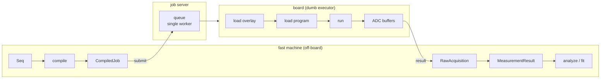

# The job manager

How Strumento talks to a board when the board is remote or shared: a **job server** (a.k.a. the job
manager) that Strumento reaches through a coarse transport, `JobServerSoc`. This is the resolved D14
design — *job-server-native, no object proxies* (D14; see [architecture.md](architecture.md)).

## The model — compile off-board, run on a dumb executor

The work splits cleanly across two machines:

- **The fast machine** (your PC) owns everything expensive: build the sequence, **compile** it to a
  tProc-v2 program, and later **analyze/fit** the results. All of this is offline — no board.
- **The board** is a **dumb executor**: *load a firmware overlay → load the compiled program → run
  → return ADC buffers.* Nothing more.

That split is what `QickConfig.dump_cfg()` unlocks: once the whole build+compile of an
`AveragerProgramV2` happens off-board, the only board-side operation left is coarse — one job in,
raw IQ out. That's a **job submission**, not a live object proxy, so there is **no Pyro**: Pyro
exists to proxy fine-grained remote method calls, exactly the thing this design removes (and Pyro4
is EOL besides).



## Two seams — don't confuse them

Strumento has two distinct board-facing abstractions:

| Seam | What it is | Implementations |
|---|---|---|
| **`AbstractSoc`** (`core/soc.py`) | the board *object* the acquire loop drives, method-by-method | `MockQickSocV2`, a real `QickSoc`, `SimulatorSoc`, or the thin on-board agent's *local* soc |
| **`Transport`** (`core/transport.py`) | the off-board→board *channel* | `JobServerSoc` |

An `AbstractSoc` lives *at* the board (in-process for the mock/sim; on the board's ARM for the thin
execute-agent). A `Transport` is how the fast machine *reaches* a remote board. Swapping the board,
or the transport to it, changes nothing above these seams — which is exactly why dropping Pyro is a
one-line implementation swap.

## The wire contract

Two dataclasses cross the wire (`core/transport.py`):

- **`CompiledJob`** — what you submit: `overlay_id` (which firmware personality), `program` (the
  compiled tproc binary + envelopes, opaque to the transport), and `acquire` (run parameters:
  `reps`, `soft_avgs`, `ro_chs`, `reads_per_shot`, `expts`).
- **`RawAcquisition`** — what comes back: per-readout-channel IQ arrays. `.to_measurement_result(xpts)`
  wraps it into the same `MeasurementResult` the in-process path returns.

The transport itself treats `program` as an opaque blob — it just ships it; the board agent knows
how to load it. That keeps the contract stable regardless of how the program is compiled.

The job server's API is a tiny protocol, `JobServerClient` — `submit(job_wire) -> job_id` and
`poll(job_id) -> status`. The HTTP (or other) wiring lives in the **deployment**, not in Strumento
core; an in-process client makes the whole path testable with no server and no board.

## Example

The examples below need a device, a sequence, and a `client`. For local testing, the in-process
reference job server from `examples/jobserver/` (see [below](#the-reference-execute-agent)) stands
in for a real one: no HTTP and no board, just the mock board built from the demo's own soccfg
snapshot. Run this from the repository root:

```python
from examples.jobserver.server import InProcessClient, JobServer
from strumento import Device
from strumento.core.mock import MockQickSocV2
from strumento.packs.cqed.experiments.amplitude_rabi import AmplitudeRabi

dev = Device.load("devices/multimode_demo/device.yaml")
client = InProcessClient(JobServer(MockQickSocV2(dev.soccfg_snapshot)))   # for local testing

rabi = AmplitudeRabi(dev)
seq, _ = rabi.sequence()          # a 51-point gain sweep, bound to the declared axis "amp"
axes = rabi.axes()                # (Loop(name='amp', points=51),)
lab_telemetry = {"fridge_mK": 11.4}
```

With a real deployment, `client` is whatever implements `JobServerClient` against your server.

```python
from strumento.core.program import StrumentoProgram
from strumento.core.transport import JobServerSoc

# build + compile off-board, then extract the job (the one v2-gated bridge)
prog = StrumentoProgram(dev, seq=seq, axes=axes, reps=1000)
job = prog.to_compiled_job(overlay_id="cqed-multimode-v2")
job.acquire        # {"reps": 1000, "soft_avgs": 1, "ro_chs": [0], "reads_per_shot": [1], "expts": 51}

soc = JobServerSoc(client)          # client implements JobServerClient (submit / poll)
raw = soc.run(job)                  # submit -> poll-to-done -> deserialize  (one job in, IQ out)
result = raw.to_measurement_result(xpts=prog.xpts(), environment=lab_telemetry)
```

`overlay_id=""` (the default) means *whatever overlay is already loaded* — the single-personality lab
case. The `acquire` block is **derived from the compiled program**, never from the caller's intent:
`reads_per_shot` is the `trigger` count qick itself accumulated, and `expts` is the product of the
loop dimensions other than the averaged one. That is what lets the board validate the declared shape
against the program it reconstructed instead of trusting a hand-written number. In practice
`run_transport` (below) does all of this for you.

`JobServerSoc.run` is deliberately coarse: submit once, poll to completion, deserialize — **not** a
per-call proxy. A failed job raises `JobError`.

### Testing without a server

Because `JobServerClient` is a plain protocol, an in-process fake drives the whole transport in a
unit test — no HTTP, no board:

```python
import numpy as np

class FakeJobServer:                       # implements JobServerClient
    def __init__(self): self._jobs = {}; self._n = 0
    def submit(self, job_wire):
        jid = str(self._n); self._n += 1
        acq = job_wire["acquire"]; expts = acq.get("expts")
        iq = [np.zeros((nr, 2) if expts is None else (nr, expts, 2)).tolist()
              for nr in acq["reads_per_shot"]]
        self._jobs[jid] = {"status": "done", "acquisition": {"iq": iq}}
        return jid
    def poll(self, jid): return self._jobs[jid]

raw = JobServerSoc(FakeJobServer()).run(job)
np.asarray(raw.iq[0]).shape        # (1, 51, 2)  — (n_readouts, n_expts, IQ)
```

## Firmware overlays & multi-user

- **A firmware personality is one soccfg.** Overlays are pre-synthesized bitstreams on the board
  (synthesis is hours-long/offline, so you *select* an overlay, you don't compile gateware per job).
  Each overlay has its own `dump_cfg()` JSON — a clean 1:1 with Strumento's per-instance snapshot
  model. "Load overlay X" is just a serialized job step.
- **Hardware exclusivity is structural.** A single worker owns the board and drains a FIFO+priority
  queue, so concurrent submitters are serialized without a per-user device lock. Selecting an
  overlay needs exclusive access — which the single-worker queue already provides.

## The escape hatch (Tenet 0)

The one thing a live proxy gives that a coarse contract doesn't is interactive poking of the board.
So the job contract keeps a **raw board-exec / debug verb** — send a raw program or command straight
through — mirroring the raw-qick escape hatch elsewhere in Strumento. You never lose direct access.

## The transport-backed run path

The contract above describes what crosses the wire. `run_transport` is the whole crossing, in one
call:

```python
from strumento.core.transport import JobServerSoc, run_transport

result = run_transport(
    dev, seq,                                  # built against the device's OWN soccfg snapshot
    axes=axes,                                 # the declared loop axes the sweep is bound to
    transport=JobServerSoc(client),            # submit -> poll-to-done -> RawAcquisition
    reps=500,
    environment={"fridge_mK": 11.4},           # lab-side telemetry, read AT RECEIPT
)                                              # -> MeasurementResult, xpts from the sweep
```

Four details are deliberate:

- **Built against the instance's own snapshot.** An overlay corresponds 1:1 to a `dump_cfg()`
  snapshot (D25), so compiling against the snapshot the instance carries is what makes off-board
  compilation legitimate rather than hopeful.
- **`xpts` comes from the built program**, so the axis on the result and the axis the sweep declared
  are the same object — never two derivations that could disagree.
- **The environment is stamped client-side, at receipt** (D24/D34). Telemetry is lab-side and the
  board stays dumb, so the moment the data arrives is the earliest true reading. That stamp is also
  the *first* one, and `stamp_environment` never overwrites an existing stamp — a later layer cannot
  silently record the wrong moment.
- **`meta["transport"]`** records what was actually shipped (overlay id, reps, soft averages, reads
  per shot, experiment count), so a result taken over a wire says so.

Any shipped `Experiment` reaches a remote board through the same path via the Runner seam:

```python
from strumento import Sweep
from strumento.core.transport import TransportRunner

exp = AmplitudeRabi(dev, gains=Sweep(start=0, stop=16000, on="amp"), points=61,
                    runner=TransportRunner(JobServerSoc(client)))
outcome = exp.go(None)        # no local soc: the board is on the far side of the wire
```

`TransportRunner` forwards the loop axes the experiment declares (D36) into the program it builds,
exactly as the local `Runner` does, so a bound sweep compiles to the same program on both paths.

`go(None)` is honest, not a placeholder — in a job-server deployment there *is* no client-side board
object. Soc-only capabilities (simulator arming, per-shot collection) therefore do not apply on this
path: a simulator behind the wire is armed on the far side, by whoever owns it.

## The reference execute-agent

`examples/jobserver/server.py` is a working board-side agent — **deployment, not core**, which is why
it lives in `examples/`. It exists so the contract has a second implementer and the whole path is
testable with no board and no HTTP. Its executor is three lines, because the payload *is* qick's own
dump form:

<!-- snippet: skip reason="excerpt of execute() in examples/jobserver/server.py (bare return)" -->
```python
prog = LoadedProgram(soccfg, job.program)     # load_prog: ASM + waveforms + envelopes + dims
raw = prog.acquire(soc, rounds=soft_avgs)     # the board's local acquire loop
return RawAcquisition(iq=raw)
```

Using `dump_prog()` / `load_prog()` rather than a bespoke format is what keeps the agent dumb: it
never learns what a Rabi is, and a qick upgrade moves both ends together. The one transformation on
the client side is serialization — envelope arrays through qick's `NpEncoder` (base64 + shape +
dtype, which `load_prog` reverses) — which is what makes the payload byte-exact under
`json.dumps` → `json.loads` with no custom decoder anywhere.

Two ways to run it:

- **in-process** — `JobServer` + `InProcessClient`, which is how the tests drive it against
  `MockQickSocV2` and `SimulatorSoc`;
- **as a subprocess** — `python examples/jobserver/server.py --soccfg <dump_cfg.json>` speaks
  newline-delimited JSON on stdin/stdout, and `SubprocessClient` is a `JobServerClient` over it. A
  real process boundary with a real serialization round-trip; a deployment swaps that loop for HTTP
  and nothing above the client changes.

The agent is picky in exactly one place: before running anything it compares the **declared** acquire
block against the program it actually reconstructed (readout channels, reads per shot, experiment
count). A mismatch is a failed job with a message rather than a silently mis-shaped array — the board
is the only side that can see both. Likewise a named overlay the board does not have is a failed job,
not a guess.

## The legacy Pyro4 runner — an honest escape hatch, not a recommendation

Everything above is the resolved D14 path, and it's what any new integration should target. But
some labs' real infrastructure runs on `qick.pyro.make_proxy()` *today*, and migrating that
infrastructure to a job-server deployment is a separate, larger effort — not something this doc
can wave away. For that case, `strumento.core.legacy_pyro_runner.LegacyPyroRunner` ships
**alongside** (never replacing) `TransportRunner`: a `Runner` subclass that compiles a
`StrumentoProgram` against a constructor-supplied `soccfg` snapshot and acquires against whatever
Pyro4 proxy is handed to `.run()`/`.go()` — the compile/acquire split a fine-grained RPC proxy
needs, since routing qick v2's many compile-time reads through Pyro4 is exactly the fragile
pattern D14 exists to avoid.

**`TransportRunner`/`JobServerSoc` remain the long-term path.** `LegacyPyroRunner`'s own docstring
names the risk directly: a Pyro4 background worker thread killed by any earlier exception
silently breaks every subsequent accumulate-mode call in the same kernel session, with no
liveness check reachable through Pyro4's exposed-method boundary. Recovery is a fresh
`make_proxy()` connection, not a retry in place. See `strumento/core/legacy_pyro_runner.py` for
the class and `tests/core/test_legacy_pyro_runner.py` for its coverage.

## What's built, and what's deployment

- **Built in Strumento (pure, tested):** the `AbstractSoc` seam, the `CompiledJob` / `RawAcquisition`
  wire contract, `JobServerSoc`, the `JobServerClient` protocol, and the **transport-backed run
  path** (`run_transport` + `TransportRunner`, with receipt-time environment stamping) — verified
  against an in-process fake (`tests/core/test_transport.py`) and against the reference agent
  end to end (`tests/e2e/test_transport.py`: submit → poll → stamped `MeasurementResult`, byte-exact
  wire payloads, and a Rabi shipped over the wire whose fit recovers a simulator's perturbed ground
  truth).
- **The v2-gated bridge — now built:** `StrumentoProgram.to_compiled_job()` (with
  `core.program.compiled_payload` / `acquire_config`) extracts the compiled payload plus the acquire
  block from a really-compiled `AveragerProgramV2`. It runs offline against the committed testbench
  soccfg, so the single-channel case needs no board; multi-channel assembly still wants your own
  `dump_cfg()` (see `devices/_fixtures/README.md`).
- **Reference implementation (`examples/jobserver/`):** the execute-agent, a single-worker queue, an
  in-process client, and a subprocess client — enough to run the real path in CI.
- **Deployment / upstream (still not in `core`):** the production job-server process (queue
  durability, priorities, auth), real overlay loading, and a concrete HTTP `JobServerClient`.

See also **[getting-started.md](getting-started.md)** §12 (going to hardware) and
**[architecture.md](architecture.md#the-board-seam-d14-d25)** (the board seam) for the full
decision record.
